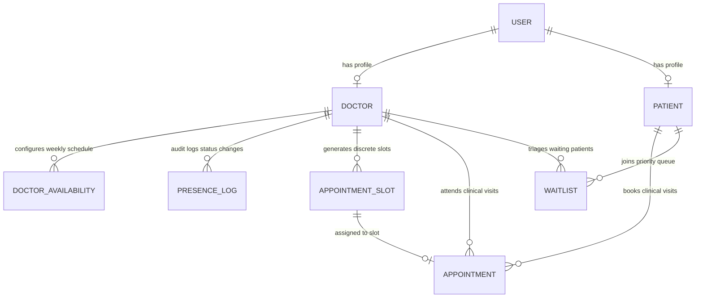

# 🗄️ MediFlow AI — Database Architecture & Schema Reference

MediFlow AI uses **PostgreSQL** as the primary relational database, orchestrated via **Prisma ORM**.

---

## 📁 Directory Structure

```text
database/
├── schema.prisma       # Complete Prisma schema definition (Models, Enums, Relations)
├── seed.js             # Automated database seeder (Doctors, Patients, Schedules)
├── migrations/         # Immutable PostgreSQL SQL migration history
├── queries.sql         # Handy SQL queries for live database verification during viva
└── README.md           # Database architecture documentation (this file)
```

---

## 📊 Entity Relationship (ER) Summary

The database consists of **7 Core Models**:



---

## 🗂️ Core Models Breakdown

### 1. `User` (Authentication & RBAC)
- **Primary Key:** `id` (UUID)
- **Fields:** `email` (Unique), `password` (bcrypt salted hash), `name`, `phone`, `role` (`ADMIN` | `DOCTOR` | `PATIENT`), `createdAt`, `updatedAt`
- **Relations:** 1-to-1 with `Doctor`, 1-to-1 with `Patient`.

### 2. `Doctor` (Clinical Specialist Profile)
- **Primary Key:** `id` (UUID)
- **Foreign Key:** `userId` (1-to-1 with `User`)
- **Fields:** `specialization`, `department`, `experience` (years), `qualification`, `consultationFee`, `consultationDuration` (default: 30 mins), `roomNumber`, `currentPresence` (`PRESENT` | `BUSY` | `AWAY` | `OFFLINE`).

### 3. `Patient` (Medical Profile)
- **Primary Key:** `id` (UUID)
- **Foreign Key:** `userId` (1-to-1 with `User`)
- **Fields:** `dateOfBirth`, `gender`, `bloodGroup`, `address`, `emergencyContact`, `medicalHistory`.

### 4. `DoctorAvailability` (Weekly Schedule Configuration)
- **Primary Key:** `id` (UUID)
- **Foreign Key:** `doctorId` (Many-to-1 with `Doctor`)
- **Fields:** `dayOfWeek` (`MONDAY` ... `SUNDAY`), `startTime`, `endTime`, `isAvailable`, `presenceStatus`.

### 5. `PresenceLog` (Clinical Presence Audit Trail)
- **Primary Key:** `id` (UUID)
- **Foreign Key:** `doctorId` (Many-to-1 with `Doctor`)
- **Fields:** `status`, `detectionMethod` (`MANUAL` | `RFID` | `FACE_RECOGNITION`), `timestamp`.

### 6. `AppointmentSlot` & `Appointment` (Scheduling Engine)
- **`AppointmentSlot`:** `slotDate`, `startTime`, `endTime`, `status` (`AVAILABLE` | `BOOKED` | `CANCELLED` | `BLOCKED`).
- **`Appointment`:** `appointmentNumber` (`APT-...`), `patientId`, `doctorId`, `slotId` (Unique), `status` (`SCHEDULED` | `CONFIRMED` | `IN_PROGRESS` | `COMPLETED` | `CANCELLED`), `reason`.

### 7. `Waitlist` (Smart Priority Triage Queue)
- **Fields:** `patientId`, `doctorId`, `priority` (`LOW` | `MEDIUM` | `HIGH` | `EMERGENCY`), `clinicalUrgency`, `priorityScore` (Formula-based calculated integer), `status` (`PENDING` | `ALLOCATED` | `CANCELLED` | `EXPIRED`).

---

## ⚡ Quick Database Commands

From the root of the project:

```bash
# Validate Prisma schema
npm run db:validate

# Apply new database migrations
npm run db:migrate

# Seed database with sample Apollo doctors & patients
npm run db:seed

# Open Prisma Studio (Visual Web Interface for PostgreSQL)
npm run db:studio
```
