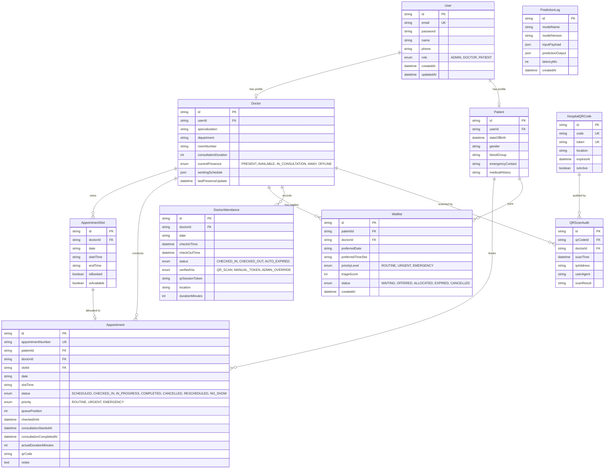

# MediFlow AI 2.0 — Database Design & Schema Specification
**Document ID:** `docs/DATABASE_DESIGN.md`  
**ORM:** Prisma 5.22.x  
**Database Engine:** PostgreSQL 15 / 16  
**Status:** Implemented & Migrated  

---

## 1. Entity-Relationship Model (ER Diagram)



---

## 2. Table Specifications & Data Integrity Rules

### 2.1 `appointments` & Prospective Timestamps
To support genuine healthcare duration analysis and training future regression models, the `appointments` table captures the full chronological lifecycle of a clinical encounter:
* `checkedInAt`: Timestamp stamped when the patient scans their QR code at the reception desk.
* `consultationStartedAt`: Timestamp stamped when the doctor clicks **"Call In Patient"**.
* `consultationCompletedAt`: Timestamp stamped when the doctor clicks **"Complete Consultation"**.
* `actualDurationMinutes`: Automatically computed as `Math.round((consultationCompletedAt - consultationStartedAt) / 60000)`.

### 2.2 Double-Booking Physical Protection
Double-booking is prevented using multiple layers:
1. **Schema Constraints:** An appointment slot is uniquely defined by:
   ```sql
   CONSTRAINT "appointment_slots_doctorId_date_startTime_key" UNIQUE ("doctorId", "date", "startTime");
   ```
2. **Transaction Isolation:** Booking endpoints execute within a `prisma.$transaction` block:
   ```javascript
   const result = await prisma.$transaction(async (tx) => {
     const slot = await tx.appointmentSlot.findUnique({
       where: { id: slotId },
     });
     if (!slot || slot.isBooked || !slot.isAvailable) {
       throw new Error('SLOT_ALREADY_BOOKED');
     }
     await tx.appointmentSlot.update({
       where: { id: slotId },
       data: { isBooked: true },
     });
     return await tx.appointment.create({ data: appointmentData });
   });
   ```

### 2.3 Authoritative Doctor Presence
To prevent contradictory states where a doctor appears offline on one screen but present on another:
* `Doctor.currentPresence` is an enum (`PRESENT`, `AVAILABLE`, `IN_CONSULTATION`, `AWAY`, `OFFLINE`).
* Check-in sessions in `DoctorAttendance` link atomically to `Doctor.currentPresence`.
* When a consultation starts, presence changes to `IN_CONSULTATION`.
* When a consultation finishes, presence reverts to `AVAILABLE`.
* When the doctor logs out or checks out via QR, presence switches to `OFFLINE`.

---

## 3. Versioned Database Migrations

MediFlow AI 2.0 uses version-controlled Prisma migrations in `database/migrations/`:

| Migration Version | Name | Description |
| :--- | :--- | :--- |
| `20261031180337` | `init` | Initial base tables (Users, Patients, Doctors, Appointments, Slots). |
| `20261031185602` | `add_doctor_presence_and_duration` | Added presence status enum and consultation duration fields. |
| `20261101071958` | `add_waitlist_urgency` | Added smart waitlist queues and triage urgency priorities. |
| `20261103035351` | `add_prediction_logs` | Added ML inference logging and audit tracking table. |
| `20261103210000` | `add_prospective_consultation_timestamps` | Added `consultationStartedAt`, `consultationCompletedAt`, and `actualDurationMinutes`. |

### Applying Migrations in Production
```bash
cd backend
npx prisma migrate deploy
```
*Note: Never run `prisma db push` in production. Always deploy committed migrations.*

