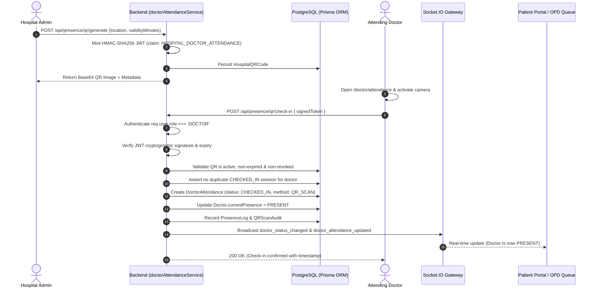

# MediFlow AI — QR Doctor Attendance System
## Phase 12 Architecture, Cryptographic Verification & Clinical Workflow

### 1. Executive Summary
The **QR Doctor Attendance System** enables automated, secure, and tamper-resistant clinician presence tracking. Hospital administrators generate cryptographically signed, location-bound, time-delimited QR codes displayed at reception or clinic wings. Doctors scan these codes directly via their device cameras to record attendance, updating real-time availability across the entire hospital system.

---

### 2. Architecture & Security Model

---

### 3. Key Security Controls
1. **Server-Side Identity Binding:** The doctor's identity is resolved strictly from the authenticated session (`req.user.id`). The client cannot pass or forge arbitrary doctor IDs.
2. **Cryptographic Tokens:** Check-in codes are signed JWT tokens containing code IDs, expiration timestamps, locations, and claim type `HOSPITAL_DOCTOR_ATTENDANCE`.
3. **Anti-Replay & Duplicate Prevention:** If a doctor already holds an active `CHECKED_IN` session, subsequent check-in attempts are rejected until checkout occurs.
4. **Administrative Revocation:** Active QR codes can be revoked instantly by hospital administration.
5. **Rate Limiting:** Sliding-window rate limiter prevents brute-force token scanning.
6. **Immutable Audit Trail:** Every scan attempt (successful or rejected) is logged in `QRScanAudit` with IP address, user agent, and failure reason.

---

### 4. Database Schema Additions
* **`HospitalQRCode`:** Stores generated codes, signatures, validity windows, locations, and revocation status.
* **`DoctorAttendance`:** Tracks attendance sessions, check-in/out timestamps, duration in minutes, and shift notes.
* **`QRScanAudit`:** Comprehensive security audit log for all scan attempts.
* **`DetectionMethod` Enum:** Extended with `QR_SCAN`.
* **`AttendanceStatus` Enum:** `CHECKED_IN`, `CHECKED_OUT`, `AUTO_CLOSED`.

---

### 5. Physical Presence Clinical Disclaimer
> **Clinical Governance Notice:** QR code scanning provides cryptographic proof of an authenticated check-in interaction at a specific hospital location. It initiates doctor presence tracking for appointment scheduling and queue management, but does not continuously guarantee uninterrupted physical room occupancy throughout the shift duration.
