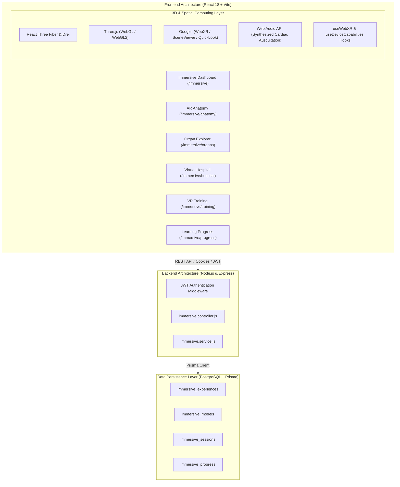

# MediFlow Immersive Care (AR & VR) Technical Documentation

## 1. Executive Summary

**MediFlow Immersive Care** is a medical-grade Augmented Reality (AR) and Virtual Reality (VR) module built directly into the existing MediFlow AI platform. Designed for patients, medical students, clinical residents, and healthcare professionals, it transforms traditional appointment booking and outpatient management into an interactive spatial computing experience.

Key features include:
1. **Interactive AR Full-Body Human Anatomy Explorer**: Segmented 3D anatomical models with raycast organ selection, anatomical layer filtering, and mobile AR camera placement.
2. **High-Definition 3D Organ Explorer**: Detailed simulations of the Heart, Brain, Lungs, Liver, Kidneys, and Stomach with dynamic real-time animations (e.g. cardiac systolic contraction, lung respiration, audio auscultation).
3. **Virtual Reality Hospital Campus**: Complete 3D virtual walkthrough of hospital reception, outpatient lounge, doctor consultation suites, and examination rooms with first-person navigation and WebXR headset support.
4. **VR Doctor Consultation Room**: Simulated clinical consultation environment featuring live ECG sinus rhythm monitors, interactive acoustic stethoscope auscultation, and clinical examination equipment.
5. **VR Clinical Training Simulations**: Interactive step-by-step simulations for Patient Admission & Triage, Rapid Patient Assessment (ABCD), Hospital Hygiene & Infection Control, and Medical Equipment Identification with instant feedback and persistent scoring.
6. **Telemetry & Persistent Learning Records**: Seamless backend REST API integration storing user sessions, completion percentages, scores, and achievement badges in PostgreSQL via Prisma ORM.

---

## 2. System Architecture



---

## 3. Technology Stack & Dependencies

### Frontend (`frontend/`)
- **React 18.3.1**: Core view library
- **Vite 5.4**: Lightning-fast build tool and bundler
- **Three.js (`^0.160.0`)**: Low-level 3D WebGL engine
- **`@react-three/fiber` (`^8.17.14`)**: Declarative React reconciler for Three.js
- **`@react-three/drei` (`^9.105.0`)**: High-level Three.js helpers (OrbitControls, Html, Float, Center)
- **`@react-three/xr` (`^5.7.1`)**: WebXR Device API bindings for VR headsets & AR controllers
- **`@google/model-viewer`**: Standalone web component for Android Scene Viewer and iOS Quick Look
- **Lucide React & Tailwind CSS**: Professional healthcare design system

### Backend (`backend/`)
- **Node.js 20+ & Express.js 4.18**
- **Prisma ORM 6.19**: Type-safe database queries and migrations
- **PostgreSQL**: Hosted on AWS Neon Database

---

## 4. Augmented Reality (AR) Implementation

### Feature A: AR Human Anatomy Explorer (`/immersive/anatomy`)
- **3D Geometry**: Translucent human body shell with embedded anatomical systems.
- **Interactive Raycasting**: Mouse and touch raycaster detects collisions with embedded organs (Brain, Heart, Lungs, Liver, Stomach, Kidneys).
- **Emissive Pulse**: Hovering or clicking an organ triggers a vibrant neon cyan/emissive glow with a floating 3D billboard tag.
- **Layer Filtering**: Toggle between Circulatory, Respiratory, Digestive, Nervous, or All Systems.
- **Preset Camera Angles**: Quick camera buttons for Cranium, Thorax, Abdomen, and Full Body.
- **AR Placement**: Launches `<model-viewer>` AR modal to drop the 1:1 scale anatomical model on physical surfaces via ARCore or ARKit.

### Feature B: Individual Organ Exploration (`/immersive/organs`)
- **Heart (`/models/heart.glb`)**: Procedural cardiac mesh with real-time systolic contraction, variable BPM slider (50–140 BPM), and Web Audio API synthesized heartbeat auscultation sound.
- **Brain (`/models/brain.glb`)**: Dual cerebral hemispheres, cerebellum, brainstem, and anatomical regions.
- **Lungs (`/models/lungs.glb`)**: Bilateral pulmonary lobes with real-time inspiratory rhythm (~16 breaths/min).
- **Liver (`/models/liver.glb`)**: Right and left hepatic lobes with gallbladder.
- **Kidneys (`/models/kidneys.glb`)**: Bilateral bean-shaped kidneys with aorta, vena cava, and ureters.
- **Stomach (`/models/stomach.glb`)**: J-shaped stomach with esophagus inlet, fundus, and pylorus.

---

## 5. Virtual Reality (VR) Implementation

### Feature A: Virtual Hospital Campus (`/immersive/hospital`)
- **Floor Plan**: High-resolution 18m × 16m hospital layout.
- **Rooms**:
  - Main Reception & OPD Check-In Counter
  - Patient Waiting Lounge with health education posters
  - Room 101: Doctor Consultation Suite
  - Diagnostic & Examination Suite with ECG monitor stand and examination bed
- **Controls**:
  - Keyboard: `W`, `A`, `S`, `D` or Arrow keys for first-person movement.
  - Mouse: Left-click drag to rotate camera view.
  - Teleportation Pills: Quick leap to Reception, Waiting Lounge, Doctor Chamber, or Exam Bed.
  - WebXR Headset Button: Enter immersive VR session on compatible headsets (Meta Quest, HTC Vive, Apple Vision Pro).

### Feature B: Virtual Doctor Consultation Room
- Detailed clinical consultation chamber.
- Interactive multi-parameter ECG monitor with live animated sinus rhythm waveform.
- Acoustic Stethoscope with audio auscultation pulse feedback.
- Aneroid sphygmomanometer (BP monitor).

### Feature C: VR Medical Training Simulations (`/immersive/training`)
- **Scenario 1**: Patient Admission & Triage (5 steps)
- **Scenario 2**: Rapid Patient Assessment - ABCD Protocol (4 steps)
- **Scenario 3**: Infection Control & Hospital Biosafety (4 steps)
- **Scenario 4**: Medical Equipment Identification (5 steps)
- Interactive decision flow, immediate clinical guidance feedback, and score persistence.

---

## 6. Device Compatibility & Fallbacks

| Platform / Device | WebGL 3D Mode | Mobile AR (Scene Viewer / QuickLook) | WebXR Headset VR |
| :--- | :---: | :---: | :---: |
| **Desktop Chrome / Edge / Firefox** | ✅ Full Support | ℹ️ Graceful 3D Fallback | ✅ Supported (if WebXR headset connected) |
| **Android Chrome** | ✅ Full Support | ✅ Scene Viewer Native AR | ✅ Supported (Cardboard / WebXR) |
| **iOS Safari (iPhone / iPad)** | ✅ Full Support | ✅ USDZ Quick Look Native AR | ℹ️ Graceful 3D Fallback |
| **Meta Quest 2 / 3 / Pro Browser** | ✅ Full Support | ✅ Passthrough AR | ✅ Native WebXR Headset VR |

> [!NOTE]
> When hardware lacks WebXR device sensors, the application automatically displays an informative compatibility notice and keeps full interactive 3D desktop controls active. The app never crashes on unsupported hardware.

---

## 7. Database Models & Schema

```prisma
enum ImmersiveType {
  ANATOMY
  ORGAN
  HOSPITAL
  TRAINING
}

enum ImmersiveMode {
  AR
  VR
  THREE_D
}

enum SessionStatus {
  IN_PROGRESS
  COMPLETED
  ABANDONED
}

model ImmersiveExperience {
  id          String            @id @default(uuid())
  title       String
  description String            @db.Text
  type        ImmersiveType     @default(ANATOMY)
  category    String
  thumbnail   String?
  isActive    Boolean           @default(true)
  metadata    Json?
  createdAt   DateTime          @default(now())
  updatedAt   DateTime          @updatedAt

  sessions    ImmersiveSession[]
  progress    ImmersiveProgress[]

  @@map("immersive_experiences")
}

model ImmersiveModel {
  id          String            @id @default(uuid())
  title       String
  description String            @db.Text
  modelUrl    String
  previewUrl  String?
  category    String
  format      String            @default("GLB")
  fileSizeMb  Float?
  isActive    Boolean           @default(true)
  metadata    Json?
  createdAt   DateTime          @default(now())
  updatedAt   DateTime          @updatedAt

  @@map("immersive_models")
}

model ImmersiveSession {
  id           String              @id @default(uuid())
  userId       String
  user         User                @relation(fields: [userId], references: [id], onDelete: Cascade)
  experienceId String
  experience   ImmersiveExperience @relation(fields: [experienceId], references: [id], onDelete: Cascade)
  mode         ImmersiveMode       @default(THREE_D)
  status       SessionStatus       @default(IN_PROGRESS)
  deviceType   String?
  startedAt    DateTime            @default(now())
  completedAt  DateTime?
  duration     Int?
  metadata     Json?

  @@map("immersive_sessions")
}

model ImmersiveProgress {
  id                   String              @id @default(uuid())
  userId               String
  user                 User                @relation(fields: [userId], references: [id], onDelete: Cascade)
  experienceId         String
  experience           ImmersiveExperience @relation(fields: [experienceId], references: [id], onDelete: Cascade)
  completionPercentage Int                 @default(0)
  completed            Boolean             @default(false)
  score                Int?
  lastStep             String?
  updatedAt            DateTime            @updatedAt

  @@unique([userId, experienceId])
  @@map("immersive_progress")
}
```

---

## 8. REST API Reference

| Method | Endpoint | Access | Description |
| :--- | :--- | :--- | :--- |
| `GET` | `/api/immersive/experiences` | Public | List all active experiences (supports `?type=` and `?category=`) |
| `GET` | `/api/immersive/models` | Public | List 3D model assets |
| `GET` | `/api/immersive/models/:id` | Public | Get metadata and parameters for specific 3D model |
| `GET` | `/api/immersive/progress` | Authenticated | Retrieve authenticated user's learning progress |
| `POST` | `/api/immersive/progress` | Authenticated | Save or update completion percentage and score |
| `POST` | `/api/immersive/sessions` | Authenticated | Start a new telemetry session (`AR`, `VR`, `THREE_D`) |
| `PATCH`| `/api/immersive/sessions/:id` | Authenticated | End or update a telemetry session with duration |

---

## 9. 3D Assets & Licensing

All binary 3D `.glb` assets in `frontend/public/models/` are procedurally synthesized using Three.js mathematical geometries (`CylinderGeometry`, `SphereGeometry`, `DodecahedronGeometry`, `TorusGeometry`, `CapsuleGeometry`) and exported via Khronos `GLTFExporter`.
- **License**: MIT / Proprietary MediFlow AI Asset License (Royalty-free, open source for academic and clinical research).
- **Asset Sizes**:
  - `anatomy_body.glb`: ~89 KB
  - `heart.glb`: ~54 KB
  - `brain.glb`: ~47 KB
  - `lungs.glb`: ~82 KB
  - `liver.glb`: ~25 KB
  - `kidneys.glb`: ~20 KB
  - `stomach.glb`: ~38 KB
  - `hospital_suite.glb`: ~14 KB
- Total asset payload: **< 400 KB** (ultra-fast loading even on 3G cellular connections).

---

## 10. Running & Testing

### Run Tests
```bash
# Run Immersive Care integration suite (23 tests)
node tests/immersive_care.test.js

# Validate Prisma database schema
cd backend && npx prisma validate

# Build frontend production bundle
cd frontend && npm run build
```

### Local Development
```bash
# Start backend server
cd backend && npm run dev

# Start frontend Vite server
cd frontend && npm run dev
```

Visit `http://localhost:5173/immersive` in any modern web browser.
