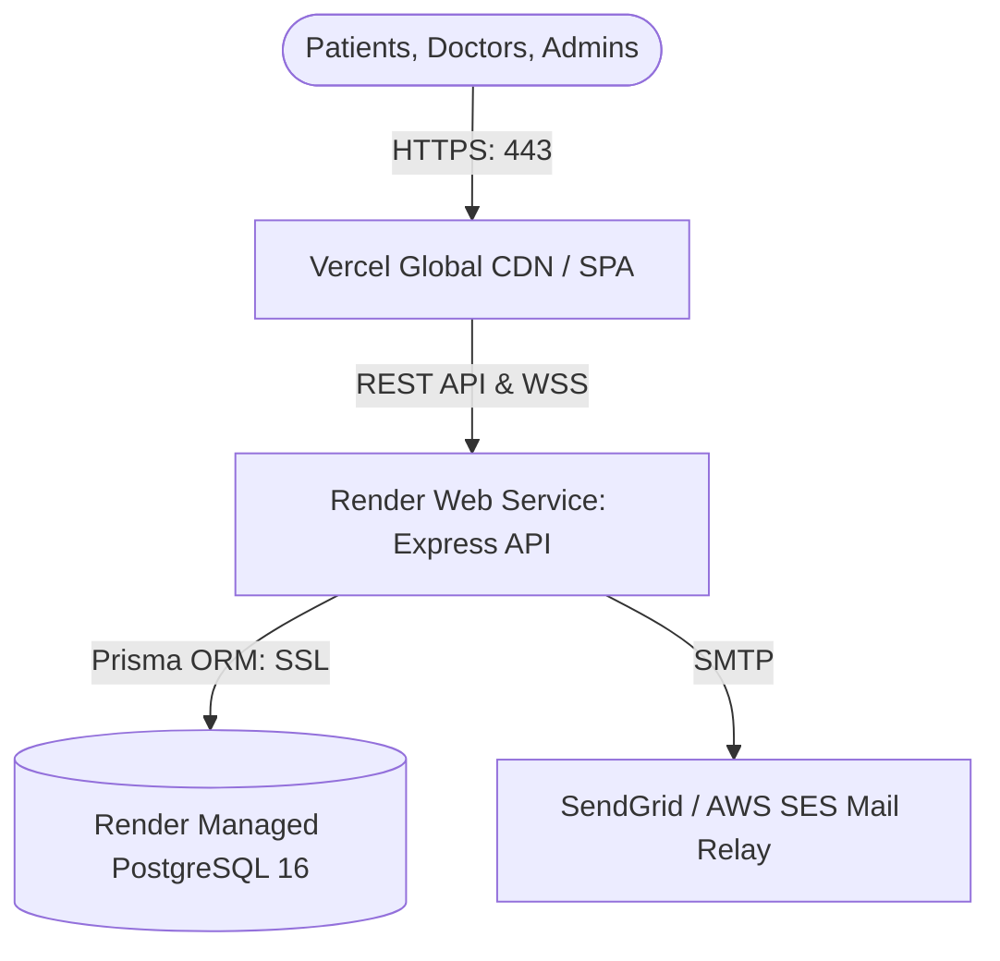

# MediFlow AI — Production Deployment & Operations Guide
**Document ID:** `docs/PRODUCTION_DEPLOYMENT_GUIDE.md`  
**Target Environments:** Cloud Platforms (Vercel + Render / Railway) & Self-Hosted Linux Infrastructure (Docker / Nginx)

---

## 1. Cloud Architecture (Vercel + Render Blueprint)



### 1.1 Step-by-Step Deployment Instructions

#### Step 1: Deploy Managed Database (Render or Supabase)
1. In your cloud console, create a new **PostgreSQL 16** database.
2. Note the internal and external **Database Connection String** (`postgresql://...`).
3. Ensure SSL is enabled (`sslmode=require`).

#### Step 2: Deploy Backend API (Render)
1. Connect your GitHub repository (`mediflow-ai`) to Render.
2. Select **Web Service** or use the included `render.yaml` blueprint.
3. Configure settings:
   * **Root Directory:** `backend`
   * **Runtime:** `Node`
   * **Build Command:** `npm install && npx prisma generate`
   * **Start Command:** `node src/server.js`
   * **Health Check Path:** `/api/health`
4. Configure Environment Variables:
   * `NODE_ENV`: `production`
   * `PORT`: `5001`
   * `DATABASE_URL`: *(Your PostgreSQL connection string)*
   * `JWT_SECRET`: *(Generate via `openssl rand -hex 32`)*
   * `CLIENT_URL`: `https://your-app.vercel.app`
5. Run migrations during release phase:
   ```bash
   npx prisma migrate deploy
   ```

#### Step 3: Deploy Frontend SPA (Vercel)
1. Import your GitHub repository into Vercel.
2. Configure project settings:
   * **Framework Preset:** `Vite`
   * **Root Directory:** `frontend`
   * **Build Command:** `npm run build`
   * **Output Directory:** `dist`
3. Configure Environment Variables:
   * `VITE_API_URL`: `https://your-api.onrender.com`
4. The included [`frontend/vercel.json`](file:///Users/sachityadav/Documents/mediflow-ai/frontend/vercel.json) automatically manages SPA rewrites (`/(.*) -> /index.html`) and security headers.

---

## 2. Self-Hosted Infrastructure (Docker Compose)

For high-security on-premise hospital deployments or dedicated VPS environments:

```bash
# 1. Clone the repository on your server
git clone https://github.com/sachityadav-2007/mediflow-ai.git
cd mediflow-ai

# 2. Configure environment
cp .env.example .env
nano .env

# 3. Build and launch staging/production containers
docker compose -f docker-compose.staging.yml up -d --build

# 4. Apply migrations inside container
docker compose -f docker-compose.staging.yml exec staging-backend npx prisma migrate deploy
```

---

## 3. Database Maintenance, Backup & Disaster Recovery

### 3.1 Automated Nightly Backup
Configure a cron job on the database server:
```bash
# Backup script: /opt/scripts/backup_mediflow.sh
TIMESTAMP=$(date +"%Y%m%d_%H%M%S")
BACKUP_DIR="/var/backups/mediflow"
mkdir -p $BACKUP_DIR

pg_dump -U mediflow_user -h localhost -Fc mediflow_prod > "$BACKUP_DIR/mediflow_$TIMESTAMP.dump"

# Retain backups for 30 days
find $BACKUP_DIR -type f -name "*.dump" -mtime +30 -exec rm {} +
```

### 3.2 Point-in-Time Recovery
To restore a snapshot:
```bash
pg_restore -U mediflow_user -h localhost -d mediflow_prod --clean --if-exists /var/backups/mediflow/mediflow_snapshot.dump
```

