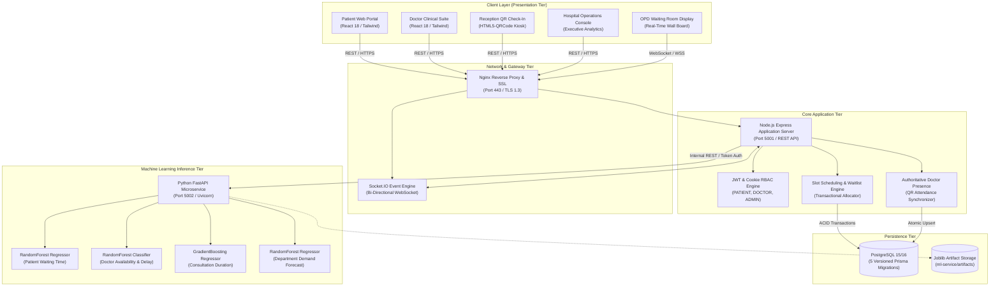
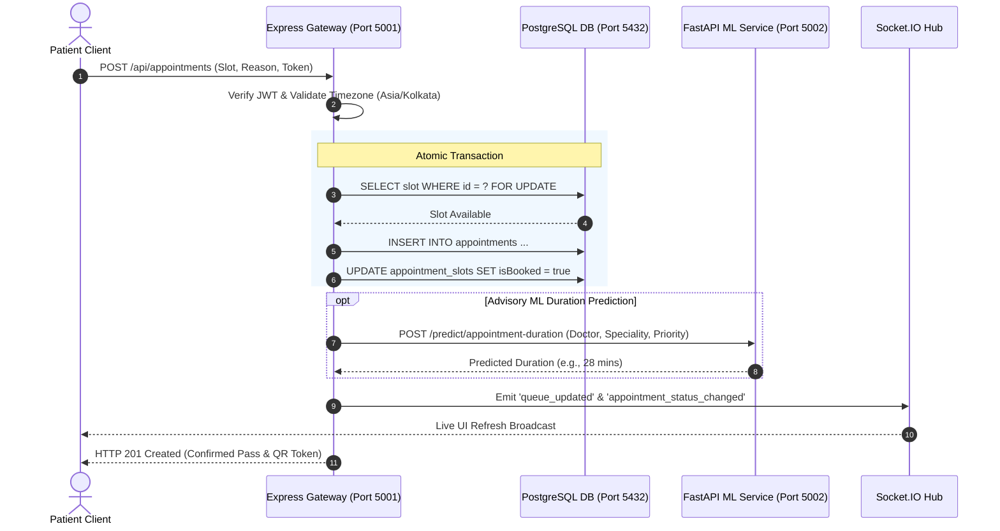

# MediFlow AI 2.0 — System Architecture Specification
**Document ID:** `docs/SYSTEM_ARCHITECTURE.md`  
**Version:** 2.0.0  
**Status:** Approved & Implemented  

---

## 1. Executive Summary & Architecture Overview

MediFlow AI 2.0 is an enterprise-grade smart hospital appointment, doctor availability tracking, patient queue orchestration, and clinical intelligence platform. The architecture is engineered around the principle of **decoupled separation of concerns**, guaranteeing that clinical workflows (appointment booking, patient reception check-in, doctor attendance, and waitlist allocations) operate with zero downtime, even if external or scientific machine learning services experience disruptions.



---

## 2. Core Subsystems

### 2.1 Frontend Presentation Tier (`frontend/`)
* **Technology:** React 18.3.1, Vite 5.4.11, Tailwind CSS 3.4.17.
* **Component Design System (`frontend/src/components/ui/`):** Standardized UI elements including `Button`, `Card`, `Badge`, `Input`, `Select`, `Table`, `Modal`, `ConfirmDialog`, `PageHeader`, `StatCard`, `EmptyState`, `ErrorState`, and `LoadingSkeleton`.
* **State & Authentication:** React Context API (`AuthContext`), persistent session bootstrap via `/api/auth/me`, and route security via `ProtectedRoute`.
* **Real-Time Integration:** `useSocket` custom hooks responding to WebSocket events (`doctor_status_changed`, `queue_updated`, `appointment_status_changed`, `waitlist_updated`).

### 2.2 Core Backend Tier (`backend/`)
* **Technology:** Node.js 20 LTS, Express.js 4.21, Prisma ORM 5.22.
* **Security & Session:** HTTP-only strict cookies storing signed JSON Web Tokens (`mediflow_token`), bcrypt password hashing (10 salt rounds), and role-based access control (`authorizeRoles('ADMIN', 'DOCTOR', 'PATIENT')`).
* **Timezone Authority:** Enforces hospital-local timezone (`Asia/Kolkata`, `+05:30`) across all date validations, preventing UTC calendar shifts.
* **Fault Isolation:** External ML calls are encapsulated in `backend/src/services/mlClient.js` with 1500ms timeouts and automatic fallback handling.

### 2.3 Machine Learning Inference Tier (`ml-service/`)
* **Technology:** Python 3.11+, FastAPI 0.115, Uvicorn, Scikit-learn 1.5, Joblib, Pandas, NumPy.
* **Model Families:**
  1. **Patient Waiting-Time Regressor:** `RandomForestRegressor` (Target: minutes waited in OPD).
  2. **Doctor Availability Classifier:** `RandomForestClassifier` (Target: presence probability and delay likelihood).
  3. **Consultation Duration Regressor:** `GradientBoostingRegressor` (Target: consultation minutes).
  4. **Department Demand Forecaster:** `RandomForestRegressor` with 7-day cyclical lag features.
* **Internal Authentication:** Enforced via `X-Internal-Token` header check on all inference and evaluation endpoints.

### 2.4 Persistence Tier (`prisma/schema.prisma` & PostgreSQL)
* **Storage Engine:** PostgreSQL 15/16.
* **Migrations:** 5 fully versioned, forward-compatible SQL migrations in `database/migrations/`.
* **ACID Transactions:** Slot booking, rescheduling, cancellation, and waitlist allocations run inside `prisma.$transaction` blocks to prevent race conditions or double-booking.

---

## 3. Communication Protocols & Security Boundaries



---

## 4. Resilience & Fallback Architecture

MediFlow AI 2.0 adheres to a strict non-blocking design:

1. **ML Service Outage Resiliency:** If `http://localhost:5002` is unreachable, `mlClient.js` catches the network error, logs a warning, and returns:
   ```json
   {
     "success": true,
     "source": "ml-service-fallback",
     "status": "insufficient_data",
     "advisory": "ML Service currently offline. Relying on confirmed hospital scheduling rules."
   }
   ```
   **Core booking, patient check-in, doctor attendance, and waitlist allocation NEVER fail due to ML microservice downtime.**

2. **WebSocket Disconnection Graceful Recovery:** The frontend client maintains an automatic 15-second HTTP polling backup. If the WebSocket server restarts or experiences network jitter, dashboards automatically reconcile their data.

3. **Database Concurrency Protection:** Double-booking is physically prevented by database unique constraints on `[doctorId, date, startTime]` and transactional slot status checks.

---

## 5. Directory Structure & Key Artifacts

```
mediflow-ai/
├── backend/                  # Express.js REST API & Business Logic
│   ├── src/
│   │   ├── controllers/      # Route controllers (appointments, doctors, auth)
│   │   ├── middleware/       # JWT auth, RBAC, error handlers
│   │   ├── routes/           # REST endpoints
│   │   ├── services/         # Waitlist allocation, ML client, QR generator
│   │   └── server.js         # Express app & Socket.IO server initialization
│   └── tests/                # Jest & integration test batteries
├── database/                 # Prisma migrations & seed scripts
│   └── migrations/           # 5 versioned SQL migration folders
├── frontend/                 # React 18 Single Page Application
│   ├── src/
│   │   ├── components/       # UI design system & shared widgets
│   │   ├── pages/            # Role-specific portals (Patient, Doctor, Admin)
│   │   ├── context/          # AuthContext session provider
│   │   └── services/         # Axios API client & Socket.IO consumer
├── ml-service/               # Python FastAPI Machine Learning Microservice
│   ├── app/
│   │   ├── routers/          # Inference & health routes
│   │   └── services/         # Model loading, feature engineering, registry
│   ├── artifacts/            # Trained Joblib model binaries
│   └── tests/                # Pytest unit and integration suites
└── docs/                     # Technical architecture, guides, and audit logs
```

